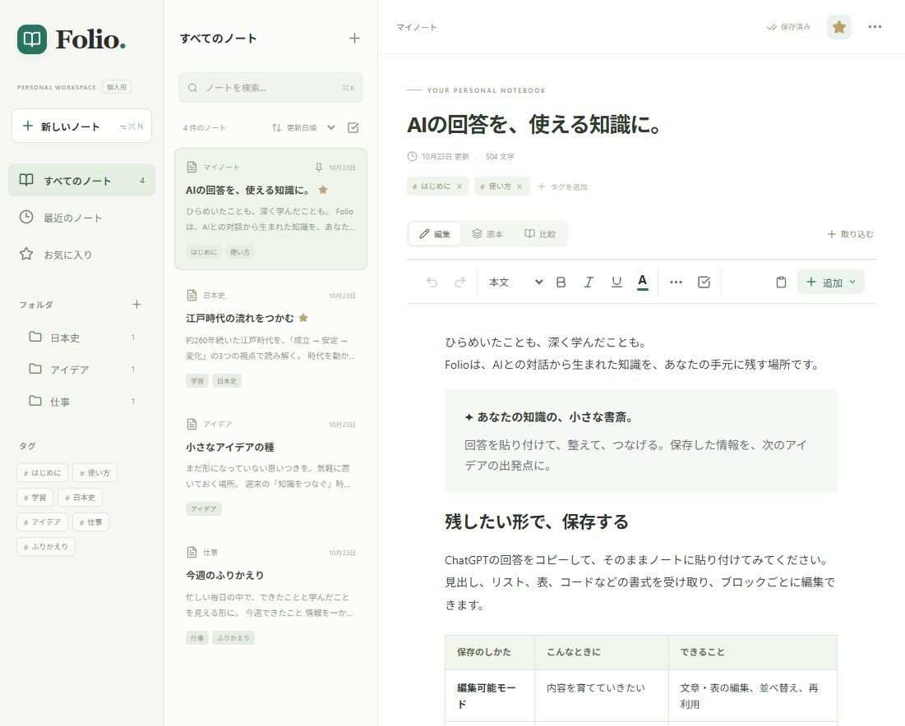

# Folio — AIノート

**使い始める：[Folioを開く](https://tarryaa.github.io/folio-ai-notes/)**

コード：[tarryaa/folio-ai-notes](https://github.com/tarryaa/folio-ai-notes)。公開済みのアプリとコードにはサンプルだけが含まれ、作成したノートは利用中の端末内に保存されます。



ChatGPT の回答や調べたことを、原本を残しながら編集・整理する個人用ノートです。白を基調に、PC では一覧と編集画面を並べ、iPhone では画面を切り替えて使います。

**ノートは利用中のブラウザ内に保存されます。GitHub にノートを送信する機能や、利用料金が発生する AI 呼び出しはありません。**

## 最初に使う

1. アプリを開き、「新規ノート」でノートを作ります。
2. ChatGPT の回答をコピーし、「取り込む」で貼り付けます。画像や HTML・Markdown ファイルも取り込めます。
3. 見た目をそのまま残したい内容は、スクリーンショットを「原本保存」で取り込みます。
4. 編集画面で文章・表・画像を整えます。「保存済み」の表示を確認してから閉じてください。
5. 定期的に「バックアップ」を使い、JSON ファイルを「ファイル」アプリや PC に保存してください。

GitHub Pagesで公開済みです。iPhoneではSafariで上記URLを開き、共有ボタン →「ホーム画面に追加」→「追加」を選んでください。詳しい手順は [公開手順](docs/deployment.md) にあります。

## 保存の考え方

| 方法 | 保存できるもの | 制約 |
| --- | --- | --- |
| 原本画像 | 読み込んだ画像の元データ、色、文字、図、細かな装飾 | 画像内の文章や表を文字として編集する機能はありません |
| 編集可能 HTML | 取得できた見出し、文章、表、画像、装飾、対応する複数列・SVG・数式 | コピー元の外部 CSS、動くグラフ、埋め込みアプリまでは複製できません |
| Markdown / テキスト | 文章、見出し、リスト、表、コード、対応する数式 | ChatGPT 画面の見た目と同じにはなりません |

原本画像はリサイズ・再圧縮せず保存し、表示するときだけ拡大縮小します。注釈は別のデータとして重ねます。HTML などの原本データも編集ブロックとは分けて保持します。外部から入る HTML は安全な要素・属性・スタイルに限定して表示します。

取得できなかった画像や書式を後から正確に推測することはできません。画面の再現性を最優先する場合は、画像の原本を併用してください。HTML 内の外部画像は、配信元が削除・変更したり、認証・通信制限があると表示できなくなります。確実に残したい画像はファイルとして取り込んでください。

## 編集・整理

- 文章、見出し、表、画像、コード、引用、区切り、数式のブロックを扱います。
- ブロックの選択・複製・コピー・削除・移動、ノート間の移動ができます。
- 原本と編集結果の比較、画像への注釈、履歴からの復元、Undo / Redo を使えます。
- フォルダとサブフォルダ、タグ、お気に入り、ピン留め、検索、並べ替え、ゴミ箱で整理します。
- JSON のバックアップと復元、ノートの HTML / Markdown / JSON 書き出しに対応します。

細かな文字・表のセル・段落の範囲は、ブラウザの通常の範囲選択でもコピーできます。離れたブロックは選択モードからまとめてコピーします。書式付きコピーは貼り付け先の対応状況によって表示が変わります。

## データとバックアップ

ノートは IndexedDB に保存します。ブラウザのサイトデータ削除、端末の初期化、空き容量不足によるブラウザ側の削除では失われる可能性があります。バックアップは外部に保存してください。アプリのゴミ箱や編集履歴だけでは、ブラウザ全体の削除から復旧できません。

バックアップの復元は既存データを置き換える操作です。現在のデータも先に書き出してください。バックアップは JSON として読み取れるため、個人情報を含む場合は保管場所と共有先に注意してください。

PC と iPhone、別ブラウザ、開発用 URL と公開用 URL のデータは自動では同期しません。URL のホストやポートが違うと保存領域も変わります。同じホストの別パスは同一オリジンのため独立した安全境界ではありません。移行にはバックアップと復元を使ってください。

## ChatGPT との関係

この版には **ChatGPT から直接ノートへ接続するサーバーはありません**。代わりに、回答の貼り付け・ファイル取り込みと、JSON の変更提案を確認してから適用するローカル API を用意しています。API キーを入力する必要はありません。

直接連携に必要な構成と、実装した操作 API は [連携設計](docs/integration.md) を参照してください。同期サーバー・OAuth・MCP 接続は今後の拡張として明確に分離しています。

## 開発・確認

Node.js 22 系以降で実行します。

```sh
npm ci
npm run dev
```

表示されたローカル URL を開きます。PWA のオフライン動作は本番ビルドで確認します。

```sh
npm test
npm run build
npm run preview
```

`build` では TypeScript と Vite の処理後、`scripts/generate-sw.mjs` がビルドした JS・CSS・数式フォントなどを列挙して Service Worker を生成します。ノートやバックアップをキャッシュに追加する処理はありません。更新は利用者が画面の通知から反映します。

取り込み比較用データ: [public/examples/rich-answer.html](public/examples/rich-answer.html)。ブラウザで表示した原本と、アプリへファイルを取り込んだ表示を比較できます。日本語、罫線付き表、画像、SVG 図、MathML、カード、2 列、引用、コード、空白を含み、外部リソースに依存しません。

実施結果と確認範囲は [テスト記録](docs/testing.md) を参照してください。iPhone 実機の確認が済むまでは、実機動作確認済みとは扱いません。

## 構成と変更しやすさ

`src/core/types.ts` がバージョン付き保存形式、`src/core/import.ts` が無害化・取り込み・コピー・バックアップ、`src/core/ai.ts` が検証付き変更 API を担当します。UI、保存処理、取り込み処理を分離し、同期先や OCR・AI 変換を後から追加できる境界を設けています。

保存形式は `schemaVersion: 1` です。異なる将来版を無理に読み込まず、検証と移行処理を追加してから対応する方針です。原本・ブロック・編集履歴を分けているため、編集エンジンを変更しても原本を基準に再取り込みできます。

## 現在の制約

- OCR、画像内文字の編集、自動 AI 変換、端末間の自動同期、直接 MCP 接続は含みません。
- 取り込み元の HTML が持たない CSS・フォント・インタラクティブ表示は復元できません。
- 外部画像は通信状態・配信元に依存します。保存したローカル画像や埋め込み画像はオフラインでも扱えます。
- コピー・ペーストの許可、画像コピー、ホーム画面アプリへの引き継ぎは iOS の版や操作方法に依存します。通常の貼り付けとファイル取り込みを代替手段として用意しています。
- 大量画像はブラウザの保存容量と端末メモリを使います。件数によらず無制限の保存を保証する設計ではありません。
